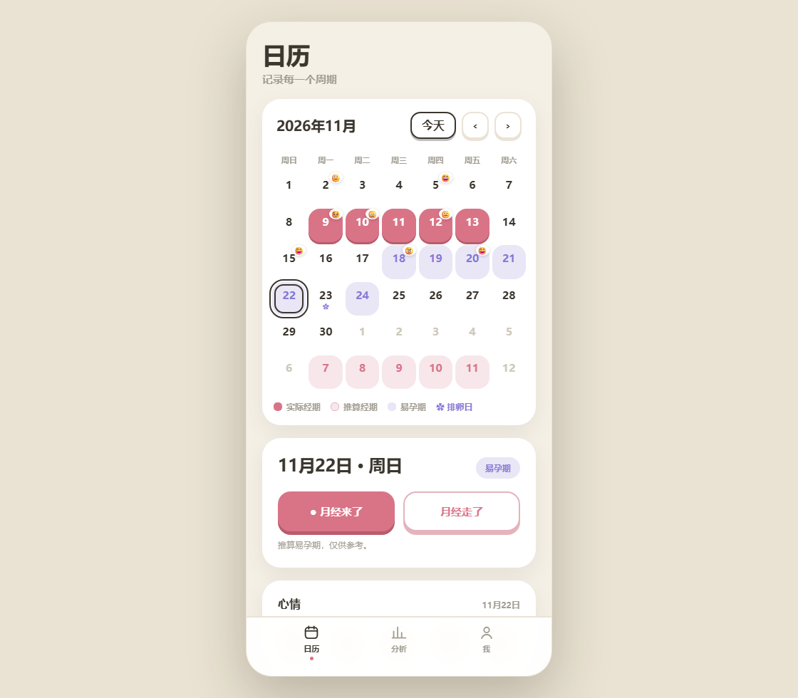
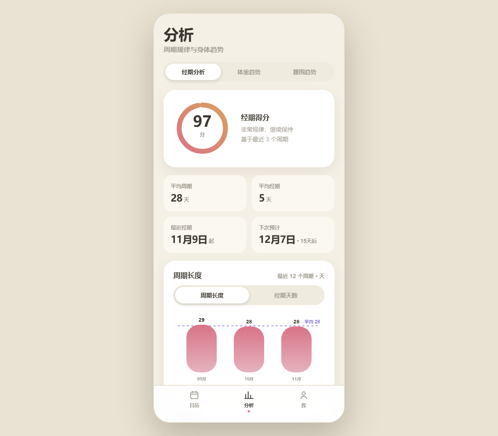
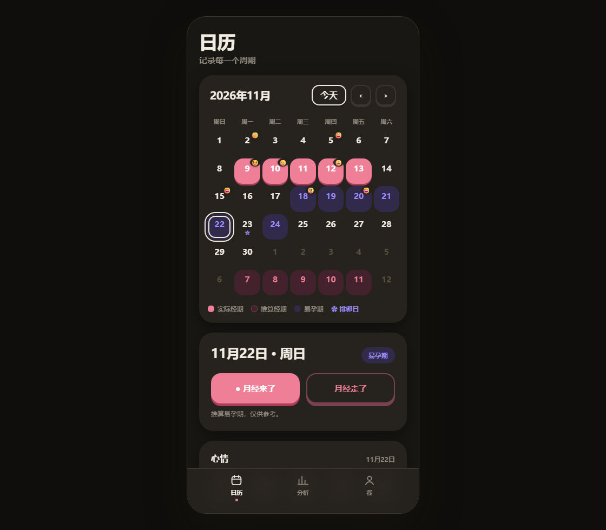
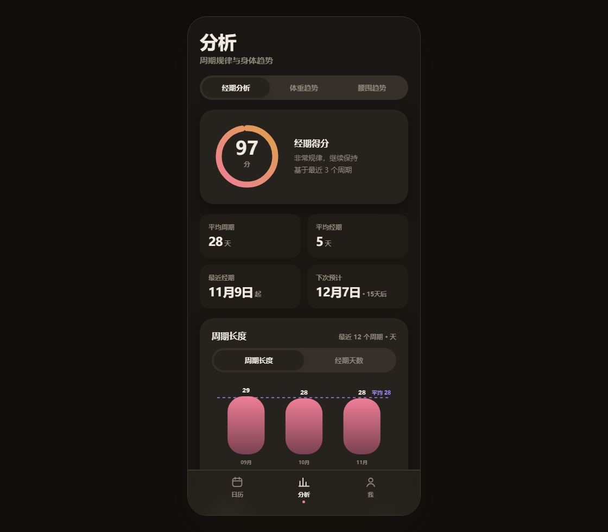

# 🌙 经期小记 · Period Xiaoji

一款 **100% 完全离线** 的安卓经期记录 App：零联网权限、零广告、零统计，所有数据只保存在你自己的手机上。
A **100% offline** period tracker for Android: zero network permission, no ads, no tracking — all data stays on your phone.

> 🔑 本仓库只发布安装包（APK），不公开源码。App 采用激活码解锁：**¥1 / $1 买断，永久使用**。
> This repo publishes the APK only (no source code). The app unlocks with an activation code: **one-time ¥1 / $1, yours forever**.

## 📸 截图 / Screenshots

| 亮色 · 日历 | 亮色 · 分析 |
| --- | --- |
|  |  |
| **暗色 · 日历** | **暗色 · 分析** |
|  |  |

## 📥 下载 / Download

**👉 [下载 APK · Download APK（v1.3 付费版）](https://github.com/Agnes-studio/period-xiaoji/raw/main/period-xiaoji-v1.3-paid.apk)**

传到手机上点开即可安装（需允许「安装未知来源应用」）。首次打开需输入激活码。
Transfer the APK to your phone and tap to install (allow "install from unknown sources"). An activation code is required on first launch.

## 🔑 获取激活码 / Get Your Activation Code

**国内用户（¥1）：** 在 **面包多** 购买，支付后**自动发货**激活码，无需等待。
**For users in China (¥1):** buy on **Mianbaoduo (面包多)** — the activation code is **delivered automatically** right after payment.

- 🍞 面包多（¥1，微信 / 支付宝，自动发货）：店铺链接开通后更新于此 · *store link coming soon*

**海外用户（$1）：** 在 **Ko-fi** 打赏 $1，付款后点页面上的 **Message** 给我发个消息（我能看到付款记录和你的邮箱），我会把激活码发给你。
**International users ($1):** tip $1 on **Ko-fi**, then tap **Message** on my page after payment (I can see your payment record) — I'll send you the activation code.

- ☕ [Ko-fi](https://ko-fi.com/agnesxie)（Credit card / PayPal）
- ⚡ [爱发电 Afdian](https://afdian.com/a/Agnesxie)（微信 / 支付宝 · 打赏后请在站内联系我领取激活码）

**激活后永久有效**：覆盖更新不用重新激活；卸载重装后，激活状态会随「下载/经期小记」里的自动备份一起恢复。
**Once activated, it's forever**: updates keep your activation; after a reinstall, activation is restored automatically from the local backup file.

## ✨ 特点 / Features

- **完全离线**：没有申请联网权限，数据不出手机；日期取自系统时钟，离线同样准确
  **Fully offline**: no network permission at all; dates come from the device clock, accurate offline
- **推算 + 真实双轨**：半透明是推算经期，实心是你真实的记录；到期没手动记录会自动坐实
  **Predicted vs. actual tracks**: translucent = predicted dates, solid = your real records; overdue predictions auto-confirm
- **排卵日 / 易孕期标注**，过往周期也保留显示
  **Ovulation & fertile window marks**, kept visible for past cycles too
- **心情贴纸 / 体重 / 腰围记录**，BMI 与腰围按中国医学标准（WS/T 428-2013）给出健康评估
  **Mood stickers, weight & waist tracking**, with health assessment based on Chinese medical standards (WS/T 428-2013)
- **数据可视化**：经期得分、周期柱状图、体重 / 腰围曲线，亮 / 暗双主题
  **Beautiful charts**: cycle score, bar charts, weight & waist trends, light & dark themes
- **数据属于你**：一键导出 JSON / CSV（Excel 可直接打开），可随时导入恢复
  **Your data, portable**: one-tap export to JSON / CSV (Excel-ready), import to restore anytime

## 🔒 隐私 / Privacy

App 无任何网络请求、无广告、无统计 SDK。所有数据仅存于本机，另在「下载/经期小记」保留一份自动备份。卸载前建议在「我 → 数据」导出一次完整备份。
No network requests, no ads, no analytics SDKs. All data stays on-device, with an automatic backup kept in Downloads/经期小记/. Export a full backup from "我 → 数据" before uninstalling.

## ☕ 支持我 / Support Me

如果这个 App 帮到了你，欢迎打赏支持（打赏同样可以领取激活码，记得在平台给我发消息～）
If this app helps you, tips are welcome — a tip also gets you an activation code (just message me on the platform)!

- ⚡ [爱发电 Afdian](https://afdian.com/a/Agnesxie)（微信 / 支付宝 / WeChat / Alipay）
- ☕ [Ko-fi](https://ko-fi.com/agnesxie)（Credit card / PayPal）

## 📄 License

本仓库 APK 为付费软件，保留所有权利，未经许可不得二次分发。
The APK in this repo is paid software. All rights reserved. Redistribution is not permitted.
© 2026 Agnes-studio
